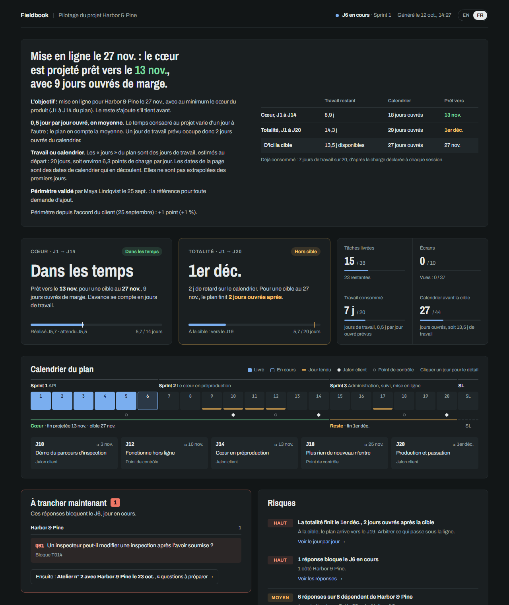

# solopilot

**Le pilotage de projet pour les développeurs solo.** Un backlog versionné, une projection honnête, un tableau de bord et un digest Slack, branchés sur [Claude Code](https://claude.com/claude-code).

[English version](README.md) · [](https://github.com/Yeloxtv/solopilot/actions/workflows/test.yml)


<sub>Rejoué depuis une vraie session des tests de bout en bout, en version condensée : les mots de Claude sont les siens. Le tableau de bord apparaît en anglais, puis en français.</sub>

Vous développez seul une vraie application pour un client. Pas de chef de projet, pas d'outil de tickets : un cahier des charges et une échéance. Tous les trois jours, les mêmes questions reviennent : *le cœur sera-t-il prêt à temps ? Qu'est-ce qui me bloque ? Qu'est-ce que j'attends du client, et pour quand ?*

solopilot y répond à partir d'un seul fichier YAML versionné dans git, sans feuille de temps. Cela coûte une journée de plan au départ, un tag sur chaque commit et dix minutes en fin de session.

## Ce qui le distingue

- **Du cahier des charges à un périmètre validé par le client.** Claude rédige les fonctionnalités, les écrans et leurs vues, les questions et l'estimation à partir des documents du projet, une étape à la fois, et vous validez chacune. Le plan devient un document de périmètre que le client valide, sans vos retards ni vos marges. Ensuite, chaque demande montre les points qu'elle ajoute, et le tableau de bord dit de combien le périmètre a grossi depuis l'accord, et d'où vient la croissance.
- **Une projection honnête.** Le plan est estimé au départ en jours de travail, chacun portant des points de charge. La projection divise ce qui reste par l'estimation du plan multipliée par la part de journée que vous donnez vraiment au projet, jamais par le rythme des premiers jours. Si vous donnez une demi-journée par jour au projet, un jour de travail prévu occupe deux jours ouvrés : le tableau de bord montre les deux. Vous vous engagez sur un cœur (du jour 1 au jour *n*) et visez le plan entier ; les deux sont suivis face à la date cible, avec la marge en jours ouvrés.
- **Les questions avant qu'elles ne bloquent.** Une question nécessaire avant le jour 9 devient urgente quand le travail atteint le jour 9, pas à une date fixée au lancement : vous n'accusez plus un client d'être « en retard » sur un point que vous n'avez pas encore atteint. Chaque réponse dit si elle a été posée, depuis combien de temps elle attend, qui relancer, et lesquelles le travail va bientôt réclamer sans que personne ne les ait posées.
- **Confidentiel par construction.** Le plan vit dans son propre dossier, à côté du projet, jamais dedans. Votre client reçoit un dépôt propre ; vos retards et vos marges restent chez vous. Seuls les identifiants de tâche voyagent avec le code, dans les messages de commit : `[T024] recherche par ville`.
- **Pensé pour Claude Code.** Le skill `/solopilot` lit vos commits taggés et propose les changements de statut. Il les écrit après votre validation, régénère le tableau de bord et poste le digest. Un hook vous rappelle quand des commits attendent d'être reportés. `solopilot projects` additionne la part de journée que chaque plan suppose et prévient quand elle dépasse une journée. Le tableau de bord, le digest et le rapport du terminal se lisent en français ou en anglais (`locale: fr`) ; le tableau de bord s'ouvre dans la langue du plan, et un sélecteur dans son en-tête passe à l'autre.

## Ce qu'il faut pour démarrer

- **Un document qui dit ce que l'application doit faire** : un cahier des charges, un brief, le compte rendu d'une réunion. Ses trous ne sont pas un problème : ils deviennent les questions à poser.
- **La date de mise en production** et **les jours vendus** au devis.
- **La part de votre journée** que vous pouvez donner au projet : une demi-journée par jour ouvré, par exemple.
- Si vous les avez : les **notes d'ateliers**, les **maquettes** (images, PDF, liens Figma) et le **devis** lui-même.
- Sur votre machine : [Claude Code](https://claude.com/claude-code), Node.js 20 ou plus, et git.

## L'essayer

Tirez le premier plan de Fieldbook, un projet fictif, de ses documents : un cahier des charges, les notes d'un atelier de lancement, un devis et deux maquettes. Avec `--locale fr`, ils sont en français.

```bash
npm install -g solopilot
solopilot init fieldbook-pilot --example --locale fr   # les documents de Fieldbook arrivent dans sources/
cd fieldbook-pilot                                     # puis, dans Claude Code : /solopilot
```

Ou voyez où en est Fieldbook à mi-parcours, avec son tableau de bord :

```bash
git clone https://github.com/Yeloxtv/solopilot && cd solopilot
npm install
npm run demo:fr                            # puis ouvrir examples/demo-fr/build/index.html
```



[examples/demo-fr](examples/demo-fr) contient les deux : les documents dans `sources/`, et le plan tel qu'il est le 21 octobre, au bout d'un mois. [examples/demo](examples/demo) raconte la même histoire en anglais.

## Démarrage rapide

```bash
npm install -g solopilot

solopilot init ../acme-pilot --locale fr   # un dossier de pilotage à côté du projet
cd ../acme-pilot
# déposer cahier des charges, notes d'ateliers et maquettes dans sources/, puis dans Claude Code : /solopilot
solopilot status                           # où en est le premier plan, étape par étape
solopilot baseline                         # une fois le plan convenu
solopilot install ../acme                  # le brancher sur Claude Code pour ce projet
solopilot build                            # tableau de bord dans build/index.html
```

## Organisation

Un dossier de pilotage par projet, idéalement un dépôt git privé à part :

```
workspace/
├── acme/                 le projet, livré au client
└── acme-pilot/           privé, jamais livré
    ├── solopilot.yaml    la source de vérité
    ├── sources/          les documents du projet dont le plan est tiré
    ├── .env              SLACK_WEBHOOK_URL, PROJECT_REPO (non commité)
    └── build/            le tableau de bord généré (non commité)
```

`solopilot install ../acme` ne commite rien dans le projet. Il écrit dans `acme/.claude/settings.local.json`, qu'il exclut de git localement :

- les chemins des deux dossiers, pour le skill et le hook ;
- l'accès de Claude Code au dossier de pilotage ;
- le hook de rappel.

Il copie aussi le skill `/solopilot` dans `~/.claude/skills/`, partagé par tous vos projets.

## Le premier plan

Un projet signé arrive souvent avec un cahier des charges, quelques ateliers et une date, mais sans liste de fonctionnalités convenue. `solopilot init` démarre le plan en phase de planification. Déposez les documents du projet dans `sources/`, ouvrez Claude Code dans le dossier de pilotage et lancez `/solopilot`. Il rédige le plan en six étapes, chacune validée par vous avant toute écriture :

1. **Les fonctionnalités**, chacune rattachée à sa source dans les documents ; ce qu'ils excluent est gardé aussi.
2. **Les écrans et leurs vues** : par défaut, vide, chargement, erreur, variantes. Avec des maquettes, les écrans et les vues que personne n'a encore dessinés.
3. **Les questions** à trancher et **les dépendances** à recevoir, avec qui les doit.
4. **Les tâches et leur estimation**, à partir d'une grille que vous validez d'abord.
5. **Le plan daté** : vous choisissez le cœur et l'ordre, et `solopilot layout` répartit les tâches sur les jours de plan.
6. **Ce que vous pouvez promettre** : le cœur et la totalité face à la date et aux jours vendus, et ce qui passe sous la ligne si tout ne tient pas.

`solopilot baseline` enregistre alors le plan convenu, et `solopilot scope` écrit le document de périmètre pour le client : ce qui est garanti à la date, ce qui suit, ce qui n'est pas prévu ou exclu, et ce que vous attendez de lui, sans le moindre retard ni la moindre marge. Une fois qu'il l'a validé par écrit, `solopilot scope --agreed-by` enregistre son accord : toute demande ultérieure se mesure à lui. `layout` et `baseline` sont les seules commandes qui écrivent `solopilot.yaml` ; elles ne changent que leurs propres valeurs, et gardent vos commentaires et votre mise en forme.

## Au quotidien

1. Dans le projet, chaque commit qui fait avancer une tâche commence par son identifiant : `[T024] recherche par ville`, ou `[T025 S05] brancher la liste des sites`.
2. En fin de session, dans Claude Code : `/solopilot`. Le skill liste les commits taggés et propose un tableau des changements de statut avec leurs preuves, puis attend votre validation.
3. Une fois validé, il écrit `solopilot.yaml`, note la session au journal, régénère le tableau de bord, poste le digest et commite dans le dossier de pilotage.

Après un atelier client, demandez-lui de replanifier : il chiffre l'impact de chaque changement sur le cœur et sur la totalité avant d'écrire quoi que ce soit.

## Commandes

| Commande | Ce qu'elle fait |
| --- | --- |
| `solopilot init [dossier]` | Crée un dossier de pilotage, son `sources/` et un plan de départ en phase de planification, avec un premier commit |
| `solopilot init [dossier] --example` | La même chose, avec les documents de Fieldbook dans `sources/`, pour essayer le premier plan |
| `solopilot install <dépôt>` | Branche le dossier de pilotage sur un projet pour Claude Code |
| `solopilot check` | Valide `solopilot.yaml` |
| `solopilot status` | Où en est le projet : écart, projection, jour courant, alertes. En planification : les six étapes |
| `solopilot layout [--dry-run]` | Répartit les tâches estimées sur les jours de plan, en planification |
| `solopilot baseline` | Enregistre le plan convenu et clôt la phase de planification |
| `solopilot commits` | Commits taggés du projet depuis le dernier point, par tâche avec les fichiers touchés, et ce qui n'est pas encore commité dans le projet |
| `solopilot head` | Dernier commit du projet, reporté dans `project.last_commit` |
| `solopilot commit [-m <message>]` | Commite le dossier de pilotage |
| `solopilot build` | Génère `build/index.html`, et `build/publish.html` pour l'héberger ailleurs |
| `solopilot scope` | Génère le document de périmètre pour le client, `build/scope.html` à imprimer et `build/scope.md` pour un e-mail : ni retard ni marge |
| `solopilot scope --agreed-by <nom> [--on <date>]` | Enregistre l'accord du client sur le périmètre, la référence de toute demande ultérieure |
| `solopilot slack [--dry-run]` | Poste le digest sur Slack, ou l'affiche |
| `solopilot slack --milestone <n>` | Annonce le jalon du jour *n* du plan |
| `solopilot projects` | Tous vos projets, une ligne chacun, et la part de journée qui leur est promise semaine par semaine |
| `solopilot projects --forget <dossier>` | Retire un dossier de pilotage de la liste |

Options : `--dir <chemin>` (sinon `SOLOPILOT_DIR`, ou le `solopilot.yaml` le plus proche), `--today <AAAA-MM-JJ>` pour calculer à une autre date, `--locale en|fr` pour changer la langue du projet le temps d'une commande.

`init` et `install` inscrivent le dossier de pilotage dans `~/.solopilot/projects.json` (`SOLOPILOT_HOME` le déplace), la liste que lit `solopilot projects`. Elle ne contient que des chemins et ne quitte pas votre machine.

## Le backlog

Le format est en anglais, quelle que soit la langue de l'interface. Chaque section est décrite dans [docs/backlog.md](docs/backlog.md), et [examples/demo-fr/solopilot.yaml](examples/demo-fr/solopilot.yaml) montre un projet complet, ses clés en anglais et ses textes en français. Le calcul de l'écart et de la projection est expliqué dans [docs/how-it-computes.md](docs/how-it-computes.md). Les raisons de ces choix sont dans la [vision produit](docs/vision.md) et les [notes de conception](docs/design/). Toute la documentation est en anglais.

## Slack et hébergement

- **Slack** : créer une app avec Incoming Webhooks, la brancher sur un channel interne, et mettre l'URL dans `.env` sous `SLACK_WEBHOOK_URL`. Le digest montre les retards internes : ce channel ne s'ouvre pas au client.
- **Héberger le tableau de bord** : `build/index.html` est un fichier unique et autonome, hors polices. Quand `project.dashboard_url` pointe vers un artifact claude.ai, le skill y republie `build/publish.html` à chaque point, et le digest y renvoie.

## État du projet

solopilot vient d'un outil utilisé chaque jour sur un vrai projet client. Le format du fichier peut encore changer avant la 1.0. La suite est dans la [feuille de route](docs/roadmap.md).

**Vous l'essayez sur un projet ?** Racontez-le dans un [retour d'essai](https://github.com/Yeloxtv/solopilot/issues/new?template=trial-report.yml) : là où vous avez bloqué compte le plus. Les questions et les idées vont dans les [Discussions](https://github.com/Yeloxtv/solopilot/discussions), et [CONTRIBUTING.md](CONTRIBUTING.md) explique comment lancer les tests et les scénarios de bout en bout.

## Licence

[MIT](LICENSE)
