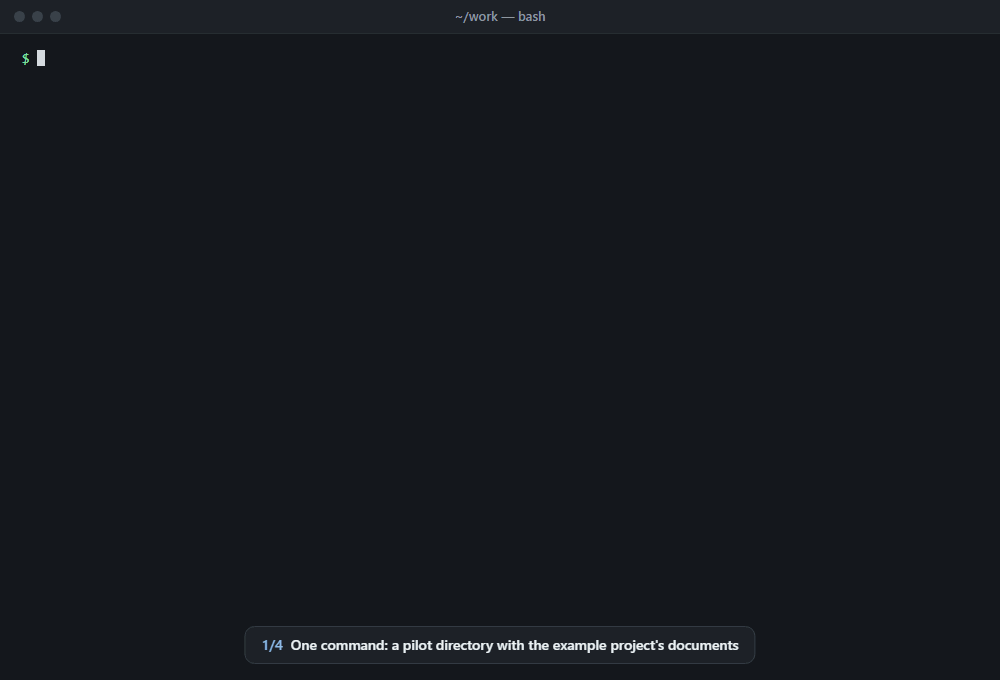
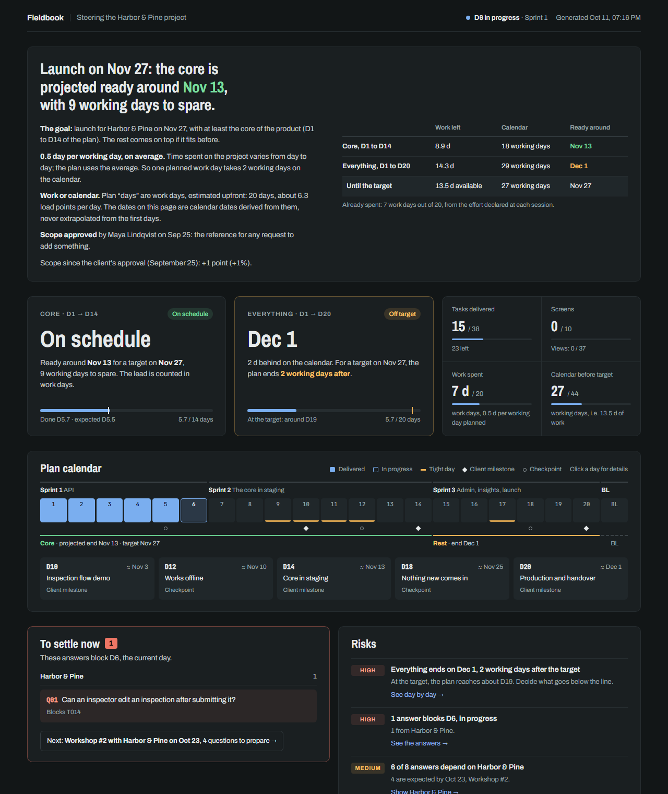

# solopilot

**Project steering for solo developers.** A versioned backlog, an honest projection, a dashboard and a Slack digest, wired into [Claude Code](https://claude.com/claude-code).

[Version française](README.fr.md) · [](https://github.com/Yeloxtv/solopilot/actions/workflows/test.yml)



<sub>Replayed from a real session of the end-to-end tests, condensed: Claude's words are its own. The dashboard is shown in English, then in French.</sub>

You are building a real app for a client, alone. No project manager, no ticketing tool, a spec and a deadline. Every few days, the same questions come back: *Will the core be ready on time? What is blocking me? What do I need from the client, and by when?*

solopilot answers them from one YAML file you keep in git, without timesheets. It costs a planning day at the start, a tag on each commit and ten minutes at the end of each session.

## What makes it different

- **From the spec to a scope the client approves.** Claude drafts the features, screens and views, questions and estimate from your project documents, one step at a time, and you approve each one. The plan becomes a scope document the client signs off, without your delays or margins. Every request after that shows the points it adds, and the dashboard tells how far the scope has grown since, and from where.
- **An honest projection.** The plan is estimated upfront in work days, each carrying load points. The projection divides what is left by the plan's own estimate times the share of your day you really give the project, never by the pace of the first days. If you give a project half of each day, one planned work day takes two working days of calendar: the dashboard shows both. You commit to a core (day 1 to day *n*) and aim for the whole plan; both are tracked against the target date, with the margin in working days.
- **Questions before they block.** A question needed before day 9 becomes urgent when the work reaches day 9, not on a date fixed at kickoff: you stop blaming a client for being "late" on something you have not reached yet. Each answer shows whether it was asked, how long it has waited, who to chase, and which ones the work needs soon that nobody has asked for.
- **Private by design.** The plan lives in its own directory, next to the project, never inside it. Your client gets a clean repository; your delays and margins stay yours. Only task ids travel with the code, in commit messages: `[T024] add search`.
- **Claude Code native.** The `/solopilot` skill reads your tagged commits, proposes status changes, writes them once you approve, rebuilds the dashboard and posts the digest. A hook reminds you when commits are waiting to be reported. `solopilot projects` adds up the share of the day every plan assumes and warns when it exceeds one. The dashboard, the digest and the terminal report read in English or in French; the dashboard opens in the plan's language, and a switch in its header changes to the other.

## What you need to start

- **A document that says what the app must do**: a spec, a brief, the minutes of a meeting. Its gaps are fine: they become the questions to ask.
- **The production date** and **the days sold** in the quote.
- **The share of your day** you can give the project: half a day per working day, for example.
- If you have them: **workshop notes**, **mockups** (images, PDF, Figma links) and **the quote** itself.
- On your machine: [Claude Code](https://claude.com/claude-code), Node.js 20 or later, and git.

## Try it

Draw up the first plan of Fieldbook, a fictional project, from its documents: a spec, kickoff workshop notes, a quote and two mockups.

```bash
npm install -g solopilot
solopilot init fieldbook-pilot --example   # the Fieldbook documents land in sources/
cd fieldbook-pilot                         # then, in Claude Code: /solopilot
```

Or see where Fieldbook stands mid-way, with its dashboard:

```bash
git clone https://github.com/Yeloxtv/solopilot && cd solopilot
npm install
npm run demo                               # then open examples/demo/build/index.html
```



[examples/demo](examples/demo) holds both: the documents in `sources/`, and the plan as it stands on October 21, a month in. [examples/demo-fr](examples/demo-fr) tells the same story in French.

## Quick start

```bash
npm install -g solopilot

solopilot init ../acme-pilot          # a pilot directory next to your project
cd ../acme-pilot
# put the spec, workshop notes and mockups in sources/, then in Claude Code: /solopilot
solopilot status                      # where the first plan stands, step by step
solopilot baseline                    # once you agree the plan
solopilot install ../acme             # wire it into Claude Code for that project
solopilot build                       # dashboard in build/index.html
```

## Layout

One pilot directory per project, ideally its own private git repository:

```
workspace/
├── acme/                 the project, handed over to the client
└── acme-pilot/           private, never handed over
    ├── solopilot.yaml    the source of truth
    ├── sources/          the project documents the plan is drawn from
    ├── .env              SLACK_WEBHOOK_URL, PROJECT_REPO (not committed)
    └── build/            the generated dashboard (not committed)
```

`solopilot install ../acme` commits nothing in the project. It writes to `acme/.claude/settings.local.json`, which it excludes from git locally:

- the paths of both directories, for the skill and the hook;
- Claude Code's access to the pilot directory;
- the reminder hook.

It also copies the `/solopilot` skill to `~/.claude/skills/`, shared by all your projects.

## The first plan

A signed project often comes with a spec, a few workshops and a date, but no agreed list of features. `solopilot init` starts the plan in a planning phase. Put the project documents in `sources/`, open Claude Code in the pilot directory and run `/solopilot`. It drafts the plan in six steps, each one approved by you before anything is written:

1. **Features**, each traced to its source in the documents; what they exclude is kept too.
2. **Screens and their views**: default, empty, loading, error, variants. With mockups, the screens and views nobody drew yet.
3. **Questions** to settle and **dependencies** to receive, with who owes them.
4. **Tasks and their estimate**, from an estimation grid you agree first.
5. **The dated plan**: you choose the core and the order, and `solopilot layout` lays the tasks out on plan days.
6. **What you can promise**: the core and everything against the date and the days sold, and what goes below the line if it does not fit.

`solopilot baseline` then records the agreed plan, and `solopilot scope` writes the scope document for the client: what is guaranteed on the date, what follows, what is not planned or excluded, and what you expect from them, without a single delay or margin. Once the client approves it in writing, `solopilot scope --agreed-by` records the approval: every later request is measured against it. `layout` and `baseline` are the only commands that write `solopilot.yaml`; they change their own values and keep your comments and layout.

## Day to day

1. In the project, start every commit that moves a task with its id: `[T024] search by city`, or `[T025 S05] wire the site list`.
2. At the end of a session, in Claude Code: `/solopilot`. The skill lists the tagged commits, proposes a table of status changes with their evidence, and waits for your approval.
3. Once you approve, it writes `solopilot.yaml`, logs the session, rebuilds the dashboard, posts the digest and commits in the pilot directory.

After a client meeting, ask it to replan: it measures the impact of every change on the core and on the whole plan before writing anything.

## Commands

| Command | What it does |
| --- | --- |
| `solopilot init [dir]` | Create a pilot directory, its `sources/` and a starter plan in the planning phase, with a first commit |
| `solopilot init [dir] --example` | The same, with the Fieldbook documents in `sources/`, to try the first plan |
| `solopilot install <repo>` | Wire the pilot directory into a project for Claude Code |
| `solopilot check` | Validate `solopilot.yaml` |
| `solopilot status` | Where the project stands: gap, projection, current day, alerts. While planning: the six steps |
| `solopilot layout [--dry-run]` | Lay the estimated tasks out on plan days, while planning |
| `solopilot baseline` | Record the agreed plan and end the planning phase |
| `solopilot commits` | Tagged project commits since the last update, grouped by task with the files they touch, and what is not committed in the project yet |
| `solopilot head` | Last project commit, recorded in `project.last_commit` |
| `solopilot commit [-m <message>]` | Commit the pilot directory |
| `solopilot build` | Generate `build/index.html`, plus `build/publish.html` to host elsewhere |
| `solopilot scope` | Generate the scope document for the client, `build/scope.html` to print and `build/scope.md` for an email: no delay or margin in it |
| `solopilot scope --agreed-by <name> [--on <date>]` | Record the client's approval of the scope, the reference for any later request |
| `solopilot slack [--dry-run]` | Post the digest to Slack, or print it |
| `solopilot slack --milestone <n>` | Announce the milestone of plan day *n* |
| `solopilot projects` | All your projects, one line each, and the share of the working day promised to them week by week |
| `solopilot projects --forget <dir>` | Take a pilot directory off the list |

Options: `--dir <path>` (otherwise `SOLOPILOT_DIR`, or the nearest `solopilot.yaml`), `--today <YYYY-MM-DD>` to compute as of another date, `--locale en|fr` to override the project's language.

`init` and `install` add the pilot directory to `~/.solopilot/projects.json` (`SOLOPILOT_HOME` moves it), the list `solopilot projects` reads. It holds paths only and stays on your machine.

## The backlog

```yaml
project:
  name: Fieldbook
  client: Harbor & Pine
  locale: en
  start: 2026-09-28      # day 1
  target: 2026-11-27     # the date you committed to
  plan_days: 20          # work days in the plan
  core: 14               # the core: day 1 to day 14
  points_per_day: 6.3    # what a full work day is worth
  focus: 0.5             # share of each working day spent on this project

features:
  - { id: F01, area: accounts, core: true, priority: 1, source: "spec.md §3.1", title: "Sign in with a link sent by email" }

days:
  - { day: 1, points: 5, title: "Repository and data model" }
  # …

tasks:
  - { id: T001, day: 1, area: setup, kind: setup, points: 1.5, status: done, done_on: 2026-09-28, title: "Repository, CI and test command" }
  - { id: S01, day: 7, area: accounts, feature: F01, points: 2, status: todo, views: [default, error, loading], title: "Sign-in screen" }

questions:
  - { id: Q01, before: 6, status: open, who: "Harbor & Pine", asked_on: 2026-10-08, title: "Can an inspector edit a submitted inspection?", tasks: [T014] }
```

Every section is described in [docs/backlog.md](docs/backlog.md), and [examples/demo/solopilot.yaml](examples/demo/solopilot.yaml) shows a complete project. How the gap and the projection are computed is explained in [docs/how-it-computes.md](docs/how-it-computes.md). Why solopilot works this way is in the [product vision](docs/vision.md) and the [design notes](docs/design/).

## Slack and hosting

- **Slack**: create an app with Incoming Webhooks, connect it to an internal channel, and put the URL in `.env` as `SLACK_WEBHOOK_URL`. The digest shows internal delays: keep the channel away from your client.
- **Hosting the dashboard**: `build/index.html` is a single self-contained file (fonts aside). When `project.dashboard_url` points to a claude.ai artifact, the skill republishes `build/publish.html` there after each update, and the digest links to it.

## Status

solopilot comes from a tool used daily on a real client project. The file format may still change before 1.0. What comes next is in the [roadmap](docs/roadmap.md).

**Trying it on a project?** Tell how it went in a [trial report](https://github.com/Yeloxtv/solopilot/issues/new?template=trial-report.yml): where you got stuck matters most. Questions and ideas go to the [Discussions](https://github.com/Yeloxtv/solopilot/discussions), and [CONTRIBUTING.md](CONTRIBUTING.md) tells how to run the tests and the end-to-end scenarios.

## License

[MIT](LICENSE)
